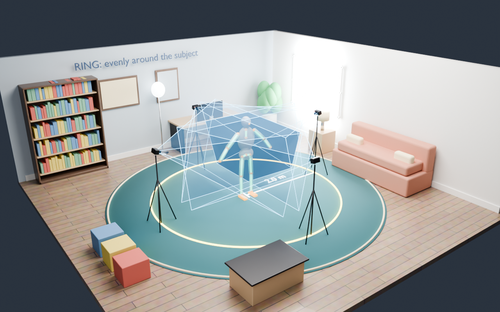
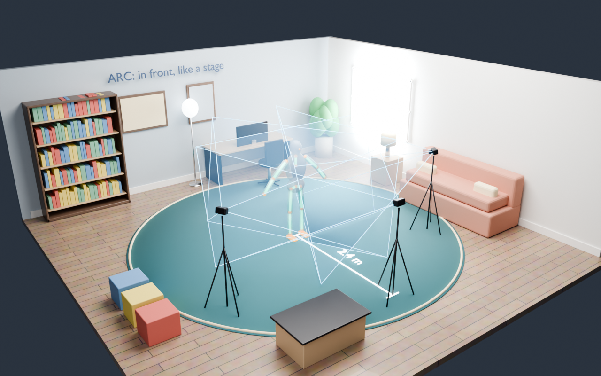
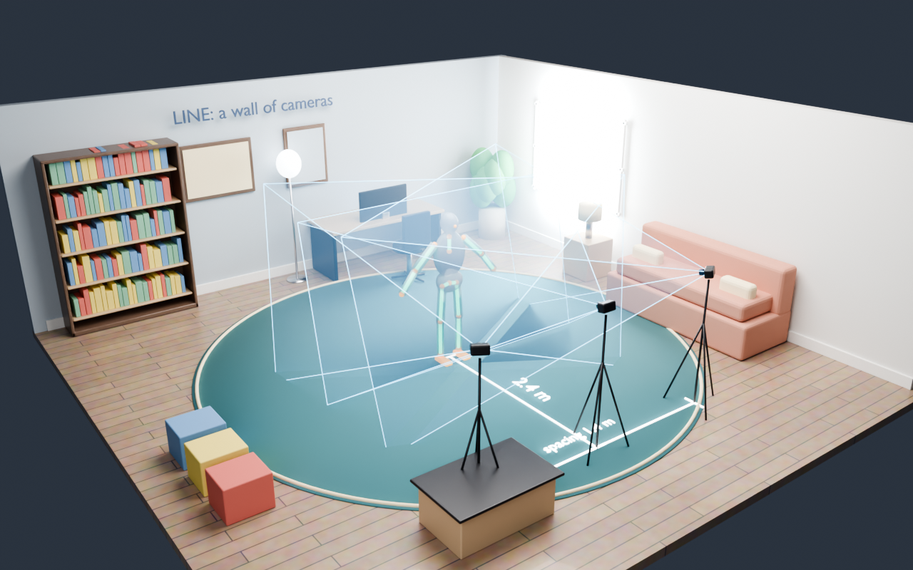
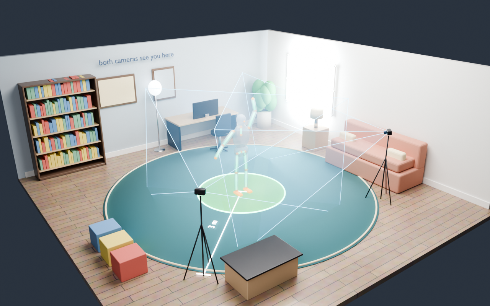
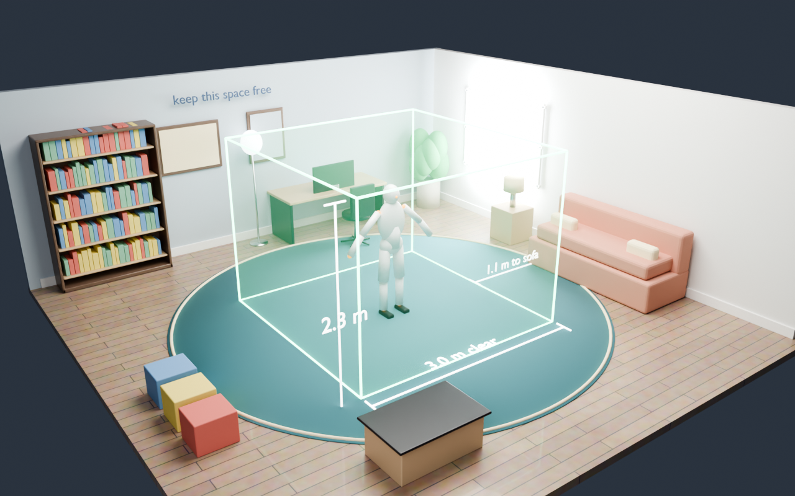

# Plugin_Mocap

Motion capture for the [Pulsar](https://github.com/Far-Beyond-Pulsar/Pulsar-Native) editor and engine
(`pulsar.mocap`): live capture from webcams with body tracking, from VMC/OSC performers and from OSC
sensors, any mix of them at once; multi-camera setup and triangulation; one fused scene view; and a
streaming take format, `.mocap`, with its own editor.

This repository is vendored into Pulsar-Native as a git submodule at `plugins/vendor/mocap`. The design
notes, format specification and status live in Pulsar-Native's `.agents/MOCAP.md`.

- [What it does](#what-it-does)
- [Setting up the cameras](#setting-up-the-cameras)
- [The editor](#the-editor)
- [Sources](#sources)
- [The `.mocap` format](#the-mocap-format)
- [Crates](#crates)
- [Building and testing](#building-and-testing)
- [Rebuilding the illustrations](#rebuilding-the-illustrations)
- [Current limits](#current-limits)

## What it does

- **Cameras.** Any number of webcams, each its own source. *Track body* runs an embedded single-person
  pose model (MoveNet Lightning, Apache-2.0, run with ONNX Runtime) on a camera's frames and publishes
  17 keypoints, drawn over the video and recorded.
- **Devices.** VMC/OSC performers (one listener per performer, from UDP port 39539) and OSC sensors
  such as IMUs (`/imu/quat`, `/imu/accel`, `/imu/gyro`, from UDP port 9100), plus a synthetic figure for
  testing.
- **Mixing.** Every running source is merged into one rig with namespaced channels
  (`<source id>/<name>`), so cameras, sensors and performers can be combined in any quantity.
- **Cameras to 3D.** With two or more cameras placed or calibrated, each keypoint is triangulated from
  every camera that sees it, so no single camera has to see the whole body.
- **One scene.** The Scene panel fuses everything into one subject (the current assumption is a single
  performer), the cameras standing where they were placed, and the sensors as axes.
- **Takes.** Recording streams to a `.mocap` file as it is captured; a crash loses at most the last block.
  The timeline scrubs a take of any length without loading it all.

## Setting up the cameras

Open the **Setup** tab. Pick how the cameras are placed, then follow the steps. Click any picture in the
panel to open it large.

No pose model accepts N cameras directly, and the camera positions are what makes triangulation
accurate, so the setup is a choice of method. Placing the cameras from measured numbers is exact and
instant; working them out from the subject's movement is the fallback when they cannot be measured.

### Ring

Cameras evenly around the subject, all aimed at them: the best coverage of the whole body. Enter the
distance, lens height and field of view, press **Place cameras**; no movement is needed.



### Arc

Cameras over a half circle in front of the subject, like a desk or a stage.



### Line

Cameras side by side in a row facing the subject, a wall of cameras.



### Movement

Cameras anywhere. The subject does a few guided movements (raise an arm, swing the arms, walk in place,
turn around); each step is detected, its samples are collected, and the panel moves on. The cameras'
positions are solved from the keypoints they share, so each camera needs to see only part of the body,
and two cameras need only a few keypoints in common. It is the least exact method: the body is
close to flat, its size is a prior, and the cameras' focal lengths are guessed.



### The space you need

Whichever method is used, keep a clear volume around the subject: about 3 m by 3 m by 2.3 m, with the
cameras outside it and furniture out of their view. The Setup panel shows this picture beside the
distances.



## The editor

One dock workspace per open `.mocap` (or a live session), over one session model:

| Where | What |
|---|---|
| Toolbar | Record, Marker, and the camera setup state |
| Left | **Sources**: add, start, stop, remove; Track body per camera |
| Centre | **Camera**: the live video on a WGPU surface with the skeleton and keypoints over it; **Scene**: the fused subject, the cameras and the sensors |
| Right | **Setup** (camera setup and calibration) and **Inspector** (the take, the selected channel, the live filter) |
| Bottom | **Timeline**: virtualized channel lanes with curves, scrubbing, zoom and markers |
| Status bar | the status line, recording statistics, how many sources are live |

## Sources

| Source | Notes |
|---|---|
| Camera | webcams via `nokhwa` (the `camera` feature); MJPEG is decoded; each is a capture thread registered as a service |
| Track body | the `pose` feature: MoveNet Lightning embedded at build time (see below), or another single-person 17-keypoint ONNX model chosen with *Pose model* |
| VMC | VMC/OSC over UDP, one per performer |
| Sensor | an OSC IMU: orientation, acceleration, angular rate |
| Synthetic | a moving figure, for testing without hardware |
| Open take | opens a recorded `.mocap` for review |

The embedded pose model is fetched by `capture/build.rs` at build time and verified against a pinned
SHA-256; a build without network access uses a model file chosen at run time instead.

## The `.mocap` format

A chunked, append-only container (`PMOC`): `META`, `RIGG` (the channel schema), `CALB` (calibration, the
cameras' poses), `BLCK` (blocks of frames, delta and zigzag varint or 16-bit quantised, then LZ4), `EVNT`
(markers) and `INDX` (a seek index, rebuilt by scanning if a take was cut short). Every chunk carries a
CRC32; a damaged block is reported with its frame range and the rest of the take still reads. A missing
sample is `NaN`, never zero. The full specification is in `.agents/MOCAP.md` in Pulsar-Native.

## Crates

| Crate | Package | What |
|---|---|---|
| root | `mocap_plugin` | the plugin: registers the editor provider and the `.mocap` file type |
| `format/` | `mocap_format` | the take format: chunks, codecs, reader and writer, rig profiles, signal tools |
| `capture/` | `mocap_capture` | sources, the frame bus, mixing, pose estimation, camera layouts and calibration, scene fusion, the recorder |
| `editor/` | `mocap_editor` | the dock workspace and its panels |

Features: `camera` (webcams) and `pose` (body tracking), both on by default.

## Building and testing

The crates are members of the Pulsar-Native workspace; build and test from there:

```
cargo test -p mocap_format -p mocap_capture -p mocap_editor
cargo test --release -p mocap_capture     # the calibration tests solve real geometry; release is much faster
```

The calibration suites generate cameras and a moving subject, add detector noise, misses, dropouts and
timing jitter, and check the solved camera positions against the truth.

## Rebuilding the illustrations

The pictures in `editor/assets/` are rendered by [Blender](https://www.blender.org) (5.x, headless) from
`editor/tools/render_setups.py`: a staged room, a mannequin with its armature, tripod cameras with their
fields of view, and the distances that matter.

```
blender -b -P editor/tools/render_setups.py -- <out dir> [samples] [name ...]
```

Names are `ring arc line body space`; the default is 128 samples. Set `MOCAP_BLEND_DIR` to also save each
scene as a `.blend`, and `MOCAP_NO_RENDER=1` to skip rendering and only save the scenes.

## Current limits

- One subject; labelling several performers is later work.
- No lens distortion model, and no per-camera time offsets; cameras are matched by arrival time.
- Calibration from movement is the least exact method; board-based calibration (ChArUco or a
  checkerboard, which also gives lens intrinsics and metric scale) is planned and not built.
- A calibration is not saved for reuse yet, and a custom layout cannot be entered camera by camera.
- Retargeting a take onto a project skeleton and baking to `.animseq`, and a playback component for
  games, are later phases.
